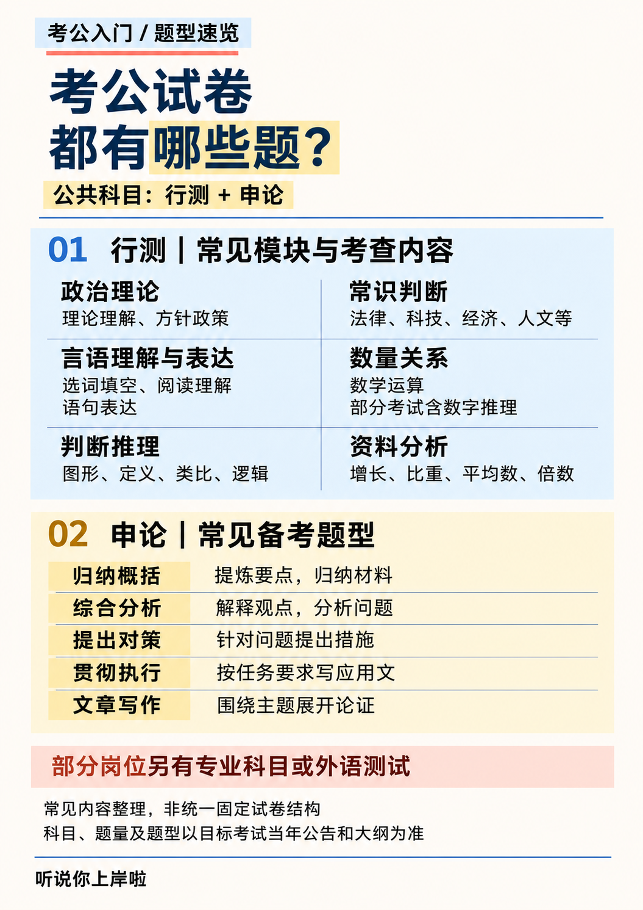
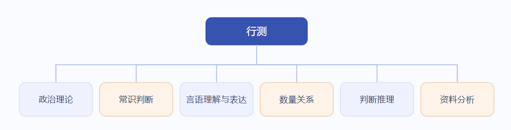
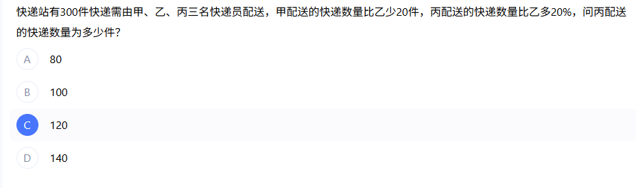

# 公务员考试考什么？

这是很多小白最关心的问题。

公务员笔试公共科目主要包括两个部分：**行测 \+ 申论。**

部分特殊职位还会有专业科目考试，具体以招考公告和职位要求为准。

## 01 行测

行测全称是《行政职业能力测验》，简单来说，就是在有限的时间内，完成大量不同类型的客观题。

常见题型主要有五个模块：

**① 言语理解与表达**

主要考查阅读理解、逻辑填空、语句表达等。

简单理解，就是考查能不能读懂材料、抓住重点、理解作者真正想表达的意思。

**② 判断推理**

包括图形推理、定义判断、类比推理、逻辑判断等。

比如给你一组图形，让你找规律；给你几个条件，让你判断谁和谁之间有什么关系。

如果你曾经觉得自己玩游戏时推理能力很强，那么这里终于有机会派上用场了。

**③ 数量关系**

主要涉及数学运算、工程问题、行程问题、排列组合、概率问题等。

对于数学基础比较好的同学来说，这个模块可能相对友好。

但如果看到数字就头疼，也不用过度焦虑，数量关系可以通过系统学习掌握常见题型和解题技巧。

**④ 资料分析**

主要考查对文字、表格、图表等统计资料的分析能力。

常见内容包括增长率、增长量、比重、平均数、倍数等。

这一部分非常值得认真准备，因为题型相对固定，计算方法也有规律。

**⑤ 常识判断**

涉及政治、经济、法律、历史、科技、地理等多个领域。

说得直白一点，就是考查知识面。

平时积累很重要，但不建议把大量时间都花在漫无目的地背常识上。

## 02 申论

如果说行测考验的是做题速度，那么申论更考验的是理解材料和组织语言的能力。

申论通常会给出一系列材料，围绕某个社会问题或公共管理主题设置题目。

常见题型包括：

- **归纳概括题：** 从材料中提取关键信息，总结主要内容。

- **综合分析题：** 分析某种现象、观点或问题。

- **提出对策题：** 根据材料中的问题提出解决措施。

- **公文写作题：** 撰写通知、倡议书、讲话稿等应用文。

- **文章写作题：** 根据给定主题写一篇议论文。

申论不是让你写得多么华丽，也不是让你疯狂堆砌名言警句。

最重要的是读懂材料、找准要点、逻辑清晰、表达规范。

所以，平时觉得自己作文不错的同学，也不要掉以轻心。

毕竟，申论不是文学创作比赛，写得感人不一定得分高，答到采分点才是硬道理。

## 03 特殊岗位

部分特殊职位除了公共科目笔试，还可能设置专业科目考试。

例如：

- 公安机关人民警察职位可能设置公安专业科目考试。

- 部分金融监管、证监等特殊职位可能设置专业科目考试。

- 其他有专业要求的职位，按照具体公告执行。

所以，报名之前一定要认真查看职位表和招考公告，别等报名结束才发现自己还漏了一门考试。
